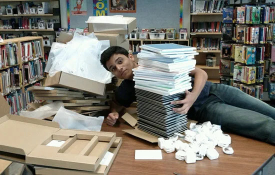

I helped implement Elsie Roy Elementary's iPad project in Yaletown as a Grade 11 student, then provided technical consultation and deployment support through 2013.

## Early iPad Adoption

[Apple announced the iPad's U.S. availability for April 3, 2010](https://www.apple.com/newsroom/2010/03/05iPad-Available-in-US-on-April-3). By late November, Elsie Roy was using 30 iPads. The [Vancouver Sun's contemporary coverage](https://vancouversun.com/news/staff-blogs/ipads-ipods-and-smart-boards-make-learning-fun-at-one-vancouver-school) called it “a pioneer among Vancouver public schools.” It identifies principal Rosa Fazio and Param Chauhan as project initiators, and names Albert Hynek and me among the Grade 11 volunteers who helped with implementation. Teachers were still experimenting with learning apps; the article reports encouraging classroom observations, not a formal evaluation.

That report documents an initial 30-iPad deployment, but does not establish a 1:1 rollout or claim Elsie Roy was the first school to use iPads. A later [Vancouver School Board account](https://www.vsb.bc.ca/education-minister-george-abbott-meets-with-the-vancouver-board-of-education-and-tours-our-schools.21784) described students using iPads and iPod touch devices to support learning during a visit showcasing personalized learning.

## Project Scope

The goal was not just to hand out tablets, but to build a personalized learning environment where technology facilitated self-directed education.

### Infrastructure & Technology Stack

To support this "Personalized Learning" framework, I assisted in deploying and configuring:

- **Mobile Device Management (MDM)**: Establishing protocols for synchronizing 30+ notebooks and mobile carts.
- **Network Architecture**: Upgrading and securing portable WiFi connectivity to handle high-density device usage in classrooms.
- **Smart Classroom Integration**: Interfacing iPads with SmartBoard technology for interactive lessons.
- **Accessibility Tools**: Configuring iPod Touch devices for Speech and Language support staff.

## Outcomes

The project shifted the school's approach from "teaching for the iPad" to "teaching *because* of the iPad." It created a seamless feedback loop where:

1. **Cloud-based workspaces** allowed universal access to assignments.
2. **Knowledge libraries** were digitized for instant troubleshooting.
3. **Student Engagement** increased significantly, with students using devices for content creation rather than just consumption (games).

> "Ms. Rosa says our teachers like them too because everyone is so engaged while working independently and responsibly." – *Student Reflection*
