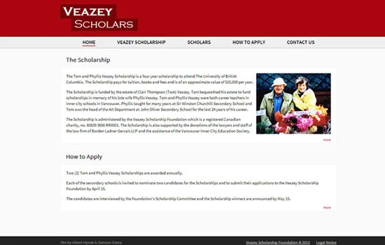

I collaborated with Albert Hynek to design and develop the digital presence for the **Veazey Scholarship Foundation**, an initiative supported by the Canadian law firm **Borden Ladner Gervais LLP (BLG)**.

The project involved creating a professional, accessible informational site for prospective applicants.

The site presented the scholarship as two annual, four-year awards to attend UBC, each worth approximately $10,000 per year for tuition, books, and fees. Its [eligibility information](https://veazeyscholars.com/veazey-scholarships/) explained that Grade 12 students admitted to UBC from nine listed Vancouver secondary schools were eligible, with selection based on academic achievement, school and community leadership, and the promise of using their education to make a positive difference.

The [application information](https://veazeyscholars.com/how-to-apply) outlined a process in which each school was invited to nominate two candidates, who would be interviewed by the Foundation's selection committee; winners were announced by late April. The site also shared the scholarship's origins in Tom Veazey's estate, honoring Tom and Phyllis Veazey, both career teachers in Vancouver inner-city schools, and acknowledged support from BLG and the Vancouver Inner City Education Society.

*Note: I was also a proud recipient of the Tom and Phyllis Veazey Scholarship, making this a project of personal significance.*

Visit this site: [veazeyscholars.com](https://veazeyscholars.com/)
