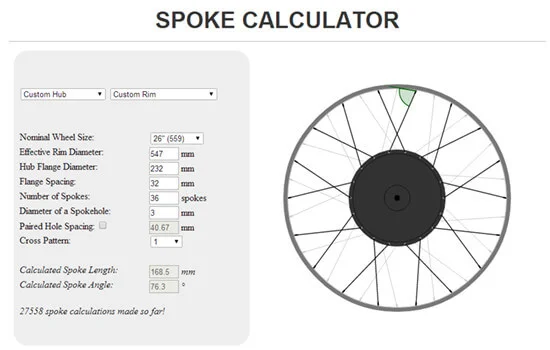

The **Spoke Calculator** is a tool I developed to help mechanics and hobbyists build hubmotor wheels. It models hub and rim geometry to estimate the correct spoke lengths for each side of the wheel. The calculator reports lengths to 0.1 mm; in practice, spokes within about 1 mm of the optimum generally work, while a 2 mm difference is less ideal.

## Features

- **Hub and rim presets**: Select from popular hub motors and GRIN rims, or enter measurements for unlisted parts. Hub dimensions can be measured with calipers; third-party rim data can be entered from its ERD and spoke-hole offsets.
- **Lacing visualization**: Render the wheel and inspect different cross patterns, including the spoke angle where each spoke enters the rim.
- **Calculated results**: Compare theoretical left- and right-side spoke lengths, tension ratio, and rim-entry angle. Settings such as paired hub holes and hub shift help represent less-standard wheel layouts.

## Tech Stack

- **Frontend**: HTML5, CSS3, JavaScript
- **Vector Graphics**: JSGL Library
- **Backend logic**: PHP (legacy support)

Try it out here: [Grin Spoke Calculator](https://ebikes.ca/resources/web-tools/spoke-calc.html)
