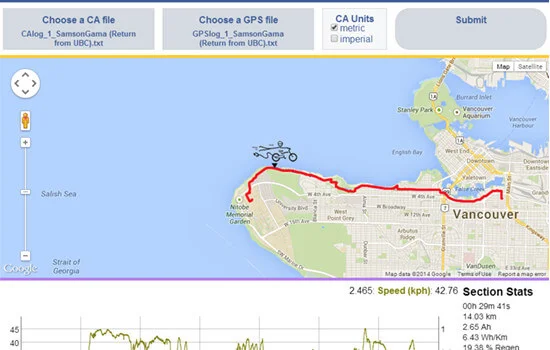

During my engineering co-op at **Grin Technologies** (ebikes.ca), I served as the lead developer for the **EV Trip Analyzer**, a web platform for scrutinizing electric bicycle performance data.

## Functionality

The Trip Analyzer is designed for post-trip analysis of journeys logged by a **Cycle Analyst**. Since the device does not save trip logs itself, riders first capture its data stream on a computer with a communications cable or a hardware logger such as the **Cycle Analogger**. GPS data can be added for route and elevation analysis.

- **Synchronized plots and maps**: With GPS data, the route appears above the graph. Hovering over a point in the graph highlights its location and shows readings such as speed, power, battery voltage, and consumed amp-hours; GPS data also enables an elevation profile.
- **Performance metrics**: Plots speed, power, efficiency (Wh/km), and regenerative-braking data against time or distance.
- **Local analysis**: Trip files are processed in the browser and are not sent to the server during analysis. Graphs and statistics work offline; displaying a Google Maps route requires an internet connection.
- **Sharing**: A separate save-and-share option uploads a trip and creates a link for sharing it with others.

## Technology Stack

- **Core**: HTML5, CSS3, PHP, JavaScript (jQuery).
- **Compression**: **LZ-String** for efficient client-side compression/decompression of large telemetry datasets.
- **Visualization**: **DyGraphs** for high-performance time-series plotting.
- **Mapping**: Google Maps JavaScript API.

Try it out here: [Grin Trip Analyzer](https://ebikes.ca/resources/web-tools/trip-analyzer.html)
