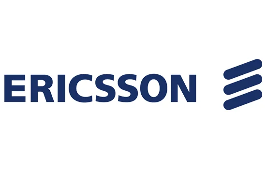

During my internship at **Ericsson**, I built the control-plane glue between **OpenStack** and virtualized Ericsson routers.

## 🤝 Key Contributions

### 1. Neutron Plugin Development

- **Software Defined Networking (SDN)**: Implemented a plugin for **OpenStack Neutron** that let OpenStack manage virtual Ericsson routers as a programmable network control plane.
- **API Integration**: Mapped standard OpenStack API calls to the specific configuration commands required by Ericsson routing hardware.


flowchart LR
    api["OpenStack Neutron API call"] --> plugin["Ericsson SDN plugin"]
    plugin --> commands["Router configuration commands"]
    commands --> router["Virtual Ericsson router"]


### 2. Testing & Automation

- **Integration Testing**: Wrote Python automation to exercise scenario-based tests across multiple environments and tighten the team's CI pipeline.
- **Dockerization**: Used Docker containers inside the OpenStack environment to isolate test components and simulate complex network topologies.

### 3. Network Security

- **Inter-VM Communication**: Investigated and implemented communication channels between virtual machines without requiring Linux interface reconfiguration at runtime.

**Tech Stack:**

- **Platform**: OpenStack (Neutron)
- **Languages**: Python, Bash
- **Tools**: Docker, Git, Jenkins
- **Domain**: SDN, Virtualization, L2/L3 Networking

[Learn more about Ericsson Virtual Routers](https://www.ericsson.com/ourportfolio/products/virtual-router)
