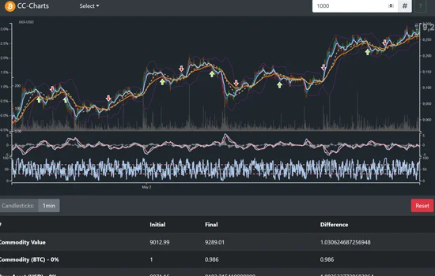



I built this high-frequency trading (HFT) system to capture volatility in cryptocurrency markets while keeping latency and operational risk under control. It grew from a simple Python scraper into a distributed system that processed live market data and backtested strategies at scale.

## 🔄 System Evolution

### 1. Data Engineering Limitations

I started with Python and PostgreSQL, but the volume of tick data from Level 2 order books created a clear bottleneck.

- **The Pivot**: Moved the core system to **Golang** to take advantage of its performance and concurrency primitives.
- **Storage**: Switched to **InfluxDB** to handle millions of data points without the write-lock overhead of relational databases.

### 2. Strategy & Analysis

- **Pattern Matching**: Implemented algorithms to detect arbitrage opportunities and market-maker patterns.
- **Machine Learning**: Used sentiment analysis and risk-assessment models to filter trade signals.

## 🏗️ Architecture

The platform used nine specialized microservices communicating over a message bus.

- **Ingestion**: Co-located VPS instances near exchange servers to minimize network latency.
- **Monitoring**: Built an observability stack with **Grafana** to track tick-to-trade latency and system health.
- **ChatOps**: Integrated **Slack** to broadcast trade decisions and predictive signals in real time.

**Tech Stack:**

- **Language**: Golang, Node.js
- **Database**: InfluxDB, MongoDB
- **DevOps**: Docker, Grafana, Promethus
- **APIs**: REST, WebSockets (Exchange Feeds)



