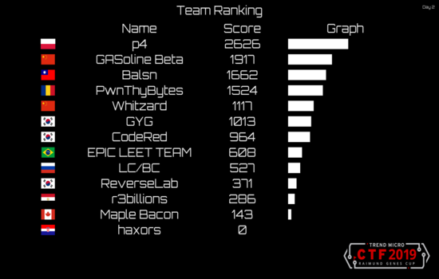



As a key member of the CTF team **Maple Bacon**, I helped secure a place in the prestigious Trend Micro CTF finals held in Tokyo, Japan.

## 🏆 The Achievement

- **Performance**: Finished **12th of 1,000 teams** in the 2019 Trend Micro CTF as a member of Maple Bacon.
- **Challenges**: The competition demanded high-pressure work in binary exploitation, IoT security, and industrial control systems (ICS).


