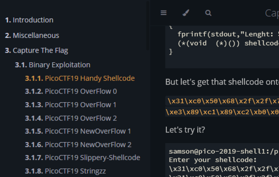



I maintain a dedicated repository of writeups for the CTF challenges I have solved. It serves as both a personal knowledge base and a public resource for security researchers who want to learn through concrete examples.

## 📂 Categories Covered

- **Binary Exploitation (Pwn)**: Buffer overflows, ROP chains, and heap exploitation.
- **Reverse Engineering**: Disassembling ELF/PE binaries to understand proprietary logic.
- **Web Security**: SQL injection, XSS, SSRF, and deserialization attacks.
- **Cryptography**: Weak encryption schemes and implementation flaws.

[Visit ctf.samsongama.com](https://ctf.samsongama.com/)
