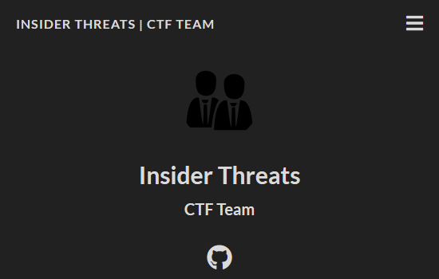

I founded **"Insider Threats"**, a Capture The Flag (CTF) team at the Mastercard Vancouver office, to build a stronger security culture and raise practical skills across the engineering organization.

## 🎯 Initiative Goals

The goal was to raise the team's understanding of offensive security concepts so we could defend our systems more effectively.

## 🛠️ Key Activities

- **Workshops & Tutorials**: I designed and led hands-on sessions covering core security topics:
  - **Binary Reversal**: Analyzed compiled executables to understand logic flow and vulnerabilities.
  - **Digital Forensics**: Investigated artifacts to reconstruct security incidents.
  - **Web Exploitation**: Worked through common issues like SQL injection and XSS.
- **Team Coordination**: Organized participation in competitive CTF events, building teamwork and improving problem-solving under pressure.
