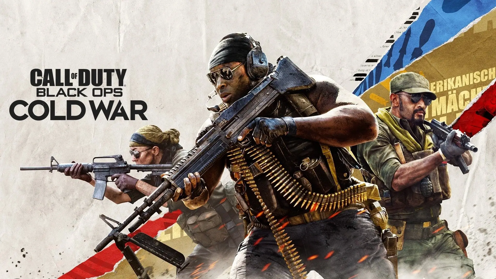

## 🎯 Scope

Supported backend services and engineering platforms behind **Call of Duty: Black Ops Cold War** at **Demonware (Activision)**, as part of the team serving millions of concurrent players.

## 🛠️ What I Owned

- **Built the load-testing backbone**: Architected and operated the distributed load-testing platform in Go, Kubernetes, and Redis to validate service capacity and failure behavior before release traffic surged.
- **Exercised real-world failure modes**: Injected latency, HTTP errors, and TLS faults to expose cascading failures, check rate-limit behavior, and pressure degraded-service paths.
- **Owned live-service incident response**: Triaged production issues during live traffic and turned recurring failures into runbooks and alerting changes that reduced repeat toil.
- **Standardized platform patterns**: Reused Helm charts and shared conf.d conventions to cut deployment drift across backend services.

## 📈 Outcomes

- Gave service owners evidence of launch capacity and failure behavior before release.
- Reduced repeat operational work by standardizing deployment and configuration patterns.
- Improved incident follow-through by closing the failure modes production kept surfacing.

I used the load-testing platform and fault injection across the Demonware titles I supported, not just one release.

**Tech Stack:**

- **Languages**: Python, C++, Go, Bash
- **Infrastructure**: Kubernetes, On-Prem
