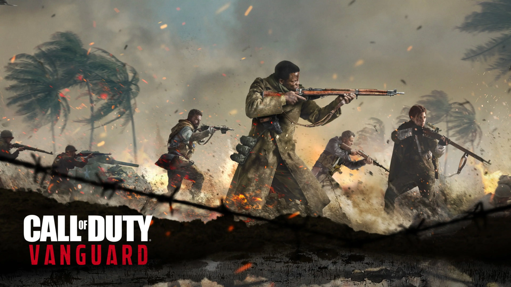

## 🎯 Scope

Supported backend services and engineering platforms behind **Call of Duty: Vanguard** at **Demonware (Activision)**, as part of the team serving millions of concurrent players.

## 🛠️ What I Owned

- **Validated launch capacity**: Ran load tests against release-candidate services to size capacity for peak multiplayer traffic and catch bottlenecks before launch.
- **Exercised failure modes**: Injected latency and error conditions to confirm rate-limit behavior, degraded-mode handling, and service stability under stress.
- **Improved backend services**: Contributed Python microservice changes behind online features, with review and safe rollout through the platform team’s release path.
- **Incident response**: Triaged production incidents and turned recurring failures into runbook and alerting changes.
- **Standardized platform patterns**: Reused Helm charts and shared templates to reduce Kubernetes drift between services and environments.

## 📈 Outcomes

- Established capacity and failure-mode evidence ahead of the release window.
- Reduced repeat operational toil through consistent deployment and configuration patterns.
- Improved incident response by feeding production findings back into alerting and runbooks.

I used the load-testing platform and fault injection across the Demonware titles I supported, not just one release.

**Tech Stack:**

- **Languages**: Python, C++, Go, Bash
- **Infrastructure**: Kubernetes, On-Prem
