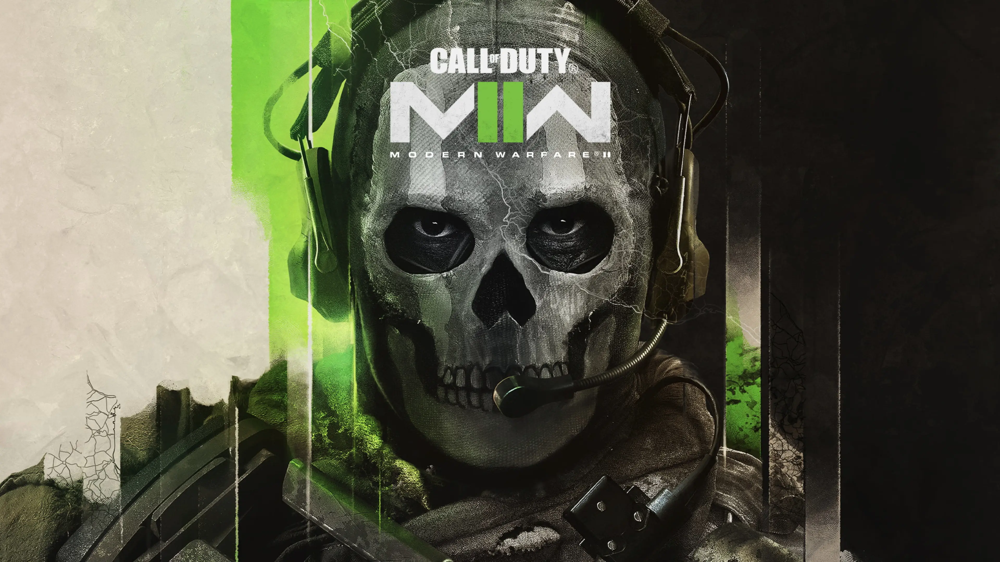

## 🎯 Scope

Supported backend services and engineering platforms behind **Call of Duty: Modern Warfare II** at **Demonware (Activision)**, as part of the team serving millions of concurrent players.

## 🛠️ What I Owned

- **Built and ran distributed load tests**: Used the internal Go, Kubernetes, and Redis platform I built to validate service capacity before peak traffic and long-running live events.
- **Injected failure modes**: Simulated latency, HTTP errors, and TLS failures to expose cascading failure paths and confirm rate-limit behavior under stress.
- **Improved backend services**: Developed and reviewed Python microservice changes behind online features, with safe rollout through the platform team’s deployment path.
- **Incident response**: Diagnosed production incidents under load and turned recurring failures into alerting and runbook changes.
- **Prepared launch readiness**: Helped prepare services and infrastructure for launch-scale demand across the release window.

## 📈 Outcomes

- Gave service owners evidence of capacity and failure behavior before launch.
- Reduced repeat operational work by automating deployment and provisioning paths.
- Shortened incident follow-up by turning repeat failures into durable platform fixes.

I used the load-testing platform and fault injection across the Demonware titles I supported, not just one release.

**Tech Stack:**

- **Languages**: Python, C++, Go, Bash
- **Infrastructure**: Kubernetes, On-Prem
