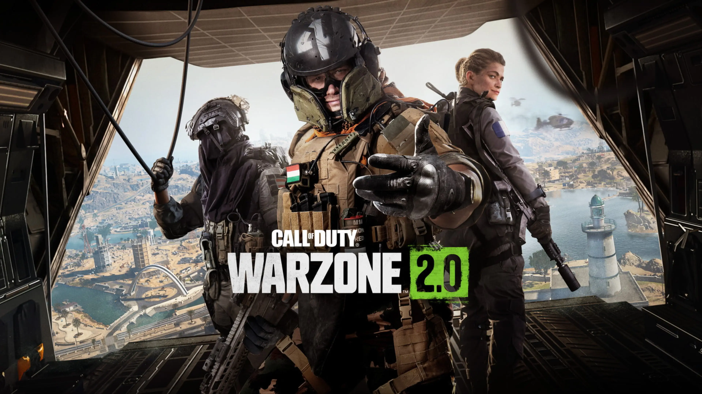

## Scope

Supported backend services and engineering platforms behind **Call of Duty: Warzone 2.0** at **Demonware (Activision)**, as part of the team serving millions of concurrent players.

## What I Owned

- **High-concurrency load validation**: Stress-tested services for sustained concurrent traffic with the internal load-testing platform built in Go, Kubernetes, and Redis.
- **Failure-mode testing**: Used configurable fault injection for latency, traffic spikes, HTTP errors, and TLS failures to check degraded-service behavior.
- **Backend service changes**: Contributed to Python microservices behind online features, with review and safe rollout through standardized deployments.
- **Incident response**: Investigated production incidents during live traffic and turned the causes into runbook and alerting updates.
- **Deployment standardization**: Applied reusable Helm charts and templates across services to reduce configuration drift.

## Outcomes

- Produced capacity and resilience evidence for services facing sustained concurrent load.
- Reduced repeat operational toil through automated deployment and provisioning workflows.
- Improved production signal quality for the services the release depended on.

*The load-testing platform, fault injection, and deployment standards described here were built and maintained across the Demonware titles I supported, not for a single release.*

**Tech Stack:**

- **Languages**: Python, C++, Go, Bash
- **Infrastructure**: Kubernetes, On-Prem
