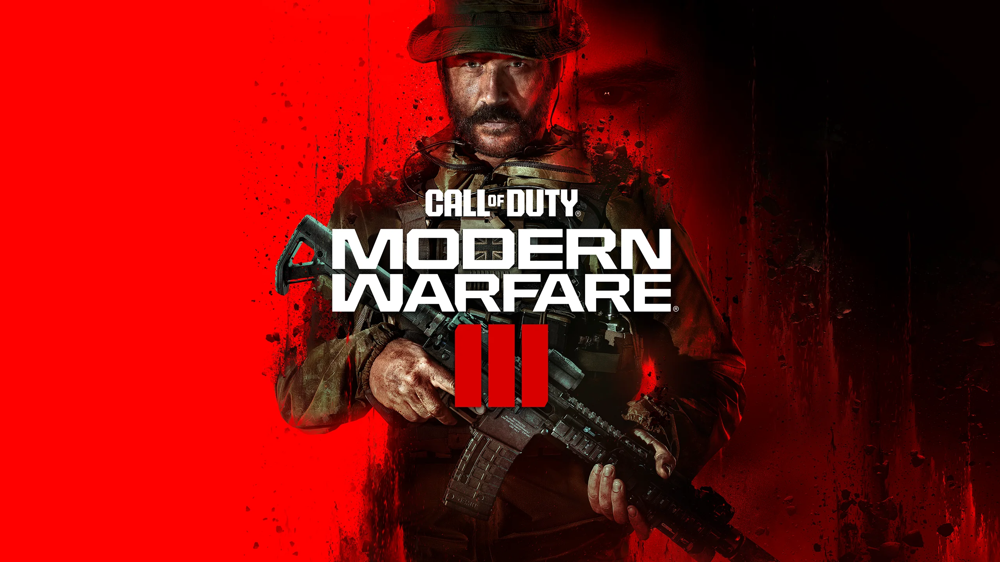

## 🎯 Scope

Supported backend services and engineering platforms behind **Call of Duty: Modern Warfare III** at **Demonware (Activision)**, as part of the team serving millions of concurrent players.

## 🛠️ What I Owned

- **Validated load and capacity**: Ran distributed load tests against release-candidate services, including extended runs ahead of peak traffic windows to gather evidence of capacity under tested conditions.
- **Exercised failure modes**: Injected faults to test rate-limit behavior, HTTP error handling, and TLS failure paths under steady load.
- **Improved backend services**: Developed and reviewed Python microservice changes behind online features, with safe rollout through the platform team’s deployment path.
- **Incident response**: Triaged production incidents under live load and converted repeat failures into runbooks and alerting changes.
- **Standardized platform deployment**: Reused Helm charts, templates, and shared configuration conventions to reduce Kubernetes drift across services.

## 📈 Outcomes

- Gathered evidence of capacity under tested conditions and documented known failure modes before the launch window.
- Reduced configuration drift across services through shared deployment templates.
- Improved incident readiness by closing the gaps production incidents exposed.

I used the load-testing platform and fault injection across the Demonware titles I supported, not just one release.

**Tech Stack:**

- **Languages**: Python, C++, Go, Bash
- **Infrastructure**: Kubernetes, On-Prem
