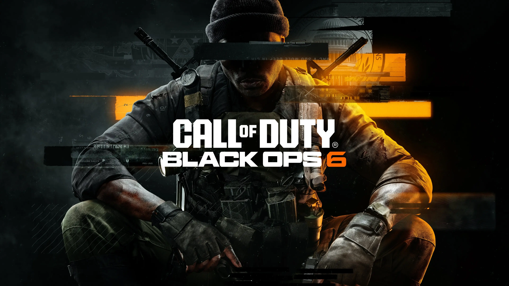

## Scope

Supported backend services and engineering platforms behind **Call of Duty: Black Ops 6** at **Demonware (Activision)**, as part of the team serving millions of concurrent players.

## What I Owned

- **Distributed load testing**: Validated release-candidate services with the internal load-testing platform in Go, Kubernetes, and Redis, including sustained runs at high request rates.
- **Fault injection**: Simulated latency, traffic spikes, HTTP errors, and TLS failures to find cascading failures before players did.
- **Backend service changes**: Contributed Python microservice changes behind online features, with code review and staged rollout.
- **Incident response**: Diagnosed production incidents during live traffic and fed the results back into alerting, runbooks, and platform fixes.
- **Deployment standardization**: Applied reusable Helm charts and templates to reduce drift between services and environments.

## Outcomes

- Gave service teams capacity and failure-mode evidence ahead of launch demand.
- Reduced repeat operational work by automating provisioning and deployment paths.
- Strengthened production signal quality on the critical service paths.

*The load-testing platform, fault injection, and deployment standards described here were built and maintained across the Demonware titles I supported, not for a single release.*

**Tech Stack:**

- **Languages**: Python, C++, Go, Bash
- **Infrastructure**: Kubernetes, On-Prem
