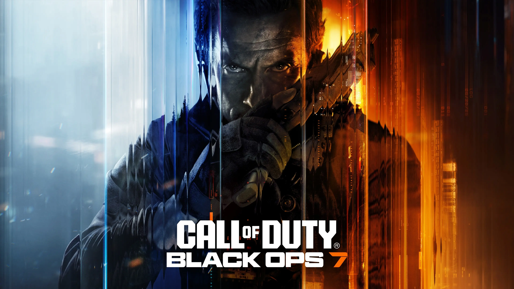

## Scope

Supported backend services and engineering platforms behind **Call of Duty: Black Ops 7** at **Demonware (Activision)**, as part of the team serving millions of concurrent players.

## What I Owned

- **Launch-scale load validation**: Ran distributed load tests with the internal platform in Go, Kubernetes, and Redis to establish capacity for peak traffic.
- **Fault injection**: Tested services under injected latency, HTTP errors, and TLS failures, including rate-limit and cascading-failure behavior.
- **Backend service changes**: Developed and reviewed Python microservice changes behind online features.
- **Incident response**: Triaged production incidents during live traffic and converted repeat failures into permanent alerting and runbook changes.
- **Deployment standardization**: Standardized Kubernetes deployments with reusable Helm charts, templates, and conf.d configuration conventions.

## Outcomes

- Established capacity and resilience evidence ahead of the launch window.
- Reduced operational toil through automated provisioning and consistent deployment patterns.
- Improved incident follow-through by closing the failure modes production exposed.

*The load-testing platform, fault injection, and deployment standards described here were built and maintained across the Demonware titles I supported, not for a single release.*

**Tech Stack:**

- **Languages**: Python, C++, Go, Bash
- **Infrastructure**: Kubernetes, On-Prem
