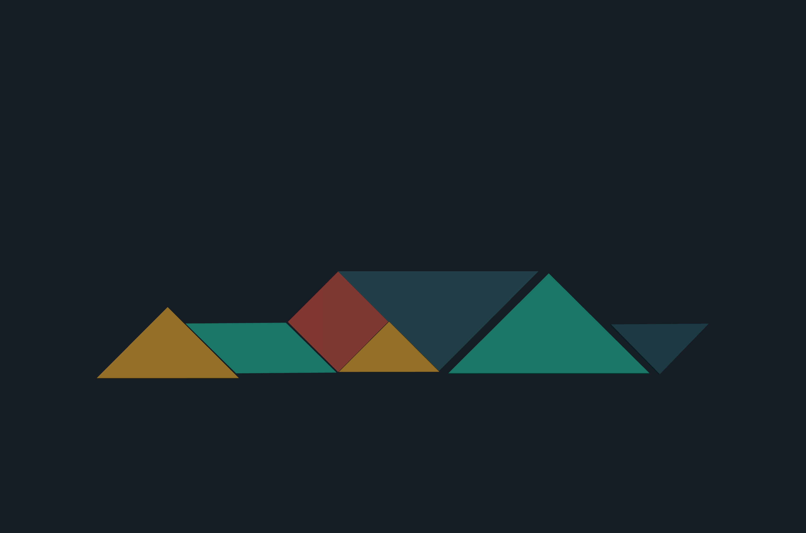

## 🎯 Scope

Operated and improved a cloud AI infrastructure platform serving AI-native teams and neo-cloud providers reselling excess GPU capacity. The work covered Kubernetes platform operations across 20 bare-metal clusters, GPU troubleshooting on NVIDIA Hopper and Blackwell, customer onboarding, and production incident response for training and inference workloads.

## 🛠️ What I Owned

- **Centralized GitOps across clusters**: Architected management of 20 bare-metal Kubernetes clusters through a single management cluster, replacing independent ArgoCD deployments and eliminating nearly 20 redundant controllers.
- **Customer onboarding**: Designed a workflow using isolated customer repositories against a shared platform monorepo, reducing new customer onboarding from roughly one day to 15 minutes and a small number of pull requests.
- **GPU troubleshooting**: Supported NVIDIA Hopper and Blackwell workloads, diagnosing issues across NVLink, InfiniBand, NVIDIA drivers, and Slurm.
- **Operational readiness**: Standardized runbooks, alerting, and incident-response workflows for AI/HPC training and inference workloads.
- **Platform operations**: Provisioned, configured, and operated Kubernetes clusters and containerized workloads across heterogeneous infrastructure, automating cluster provisioning and lifecycle work that had been manual.
- **Incident follow-through**: Investigated customer-facing incidents across networking, storage, scheduling, and system layers, then fed findings into postmortems, runbooks, and prevention work.

## 📈 Outcomes

- Removed deployment drift and redundant control-plane work across the GPU fleet.
- Cut customer onboarding from about a day to 15 minutes.
- Reduced customer workload downtime by standardizing NVIDIA tooling and incident workflows.
- Shortened diagnosis and handoff during incidents through clearer alerting and runbooks whose gaps had shown up in real incidents.

**Tech Stack:**

- **Platform**: Kubernetes (bare metal), ArgoCD, GitOps
- **Domain**: AI/HPC training and inference infrastructure
