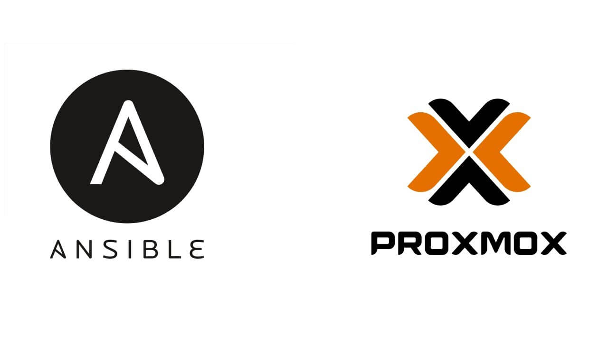

By 2015, I was starting VPSes for small projects and even short-lived proofs of concept. Each server meant repeating the same bootstrap by hand: create a user, disable root login, configure SSH keys and the firewall. That took 30 minutes to an hour, depending on what I remembered.

I had been working with Linux since 2008, but manual setup had become friction every time I wanted a public server. Heroku existed, but its free-tier CPU and memory limits did not suit what I wanted to run.

## ✅ The Solution: Ansible

I chose Ansible and Ansible Playbooks to replace that repeated setup with configuration files.

I put my default setup and SSH keys in a playbook, then ran it to configure each new VM. (I also stored passwords as base64-encoded values; base64 is encoding, not encryption.)

My setup went from as long as an hour to about **2 minutes** (VM performance can affect the run). That made spinning up a VPS for a short project practical without repeating each step manually.

## ✨ Key Benefits

- **Time Savings**: A setup that could take up to 60 minutes took about 2 minutes
- **Consistency**: Every server configured identically
- **Reproducibility**: Playbooks serve as infrastructure documentation
- **Error Reduction**: Replaces repeated manual steps with a defined playbook

I wish I knew about this sooner as I could have potentially saved **days of my life**.

If you're in a similar position of needing to set up VMs for POCs or new projects, I highly recommend adding Ansible into your automation pipeline.
