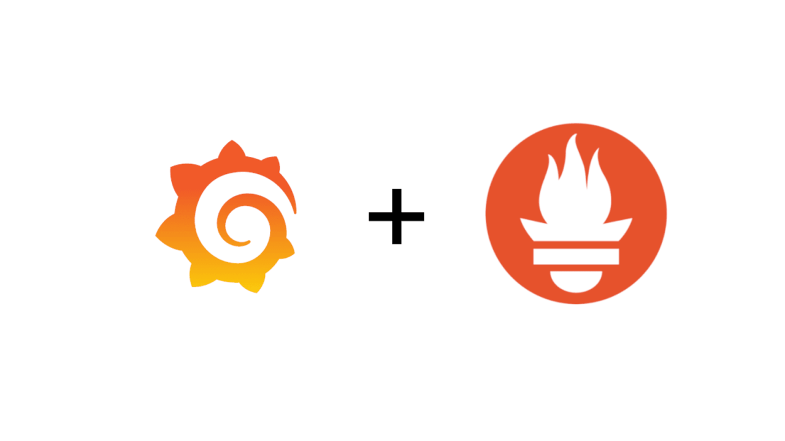

While running my [trading bot](/portfolio/2017-11-01-hft-bot/), I found that some services crashed silently. Docker Compose or Kubernetes could restart them, but repeated restarts still signaled a deeper problem. I wanted to know when a service was flapping or down without checking it manually.

This post focuses on using Prometheus and AlertManager to surface those signals and point me to the logs for diagnosis. Monitoring is a broad topic in DevOps; I group it into four categories:

## 📈 Types of Monitoring

1. **Passive Infrastructure Monitoring**: Tracking CPU, Memory, Disk usage, Uptime, and Network I/O.
2. **Log Logging/Aggregation**: Services stream their logs to a central system (ELK, Loki) where you can set alerts on specific patterns (e.g., "Exception").
3. **Active Monitoring (Synthetics)**: Pinging your servers on a timer for aliveness/health, or performing full verification of API endpoints.
4. **Application Performance Monitoring (APM)**: Metrics gathered through code injection/instrumentation to view application-level performance (e.g., function execution time, DB query latency).

## 📈 Why Passive Monitoring Matters

The focus of this post is **passive monitoring**. Unless your career depends on things working 100% of the time, you probably don't want to constantly second-guess yourself or have to manually check if your services or applications are running.

### Real-World Example: Trading Bot reliability

Repeated restarts are a symptom, not a diagnosis. An orchestrator can restart a service, but it does not explain why it keeps failing.

## ✅ The Solution: Prometheus + AlertManager

I could check Docker logs or `kubectl get pods` manually, but that would make me poll the system to discover a failure.

**My approach**: Prometheus with AlertManager can notify me when services flap, targets go down, or a threshold is crossed. I still need to inspect logs to find the cause; the alert makes the problem visible, not self-diagnosing.


flowchart LR
    host["Linux host"] --> exporter["node_exporter"]
    exporter --> prometheus["Prometheus"]
    services["Services and scrape targets"] --> prometheus
    prometheus -->|"flapping, down, or threshold alert"| alertmanager["AlertManager"]
    alertmanager --> logs["Investigate service logs"]


### Key Use Cases

**Performance Monitoring:**

- If your application becomes unstable during high load, you want to be alerted if CPU usage spans >90% or memory is exhausted (OOM Kill).
- Identifying bottlenecks to determine if you need to scale vertically (bigger server) or optimize code.
- **Tooling**: `node_exporter` is excellent for exporting Linux machine metrics to Prometheus.

**Service Health:**

- **Automatic Restart Detection**: Alert if uptime < 10 minutes.
- **Service Availability**: Alert if a scrape target is down.
- **Resource Utilization**: catch memory leaks before they crash the server.
- **Network Connectivity**: Monitor latency and packet loss between services.

## ✨ Implementation Benefits

- **Earlier signal**: Surface configured symptoms before I notice them manually.
- **Remote**: Monitor from anywhere via mobile alerts (Slack/PagerDuty).
- **Less polling**: Alert on configured conditions instead of repeatedly checking dashboards.
- **Scalable**: Works across multiple services and environments without extra effort.

**Bottom line**: If you don't have passive monitoring yet, you're flying blind and wasting time on manual checks that could be automated.
