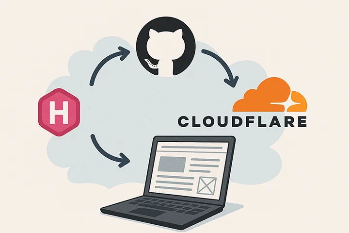

Ten years ago this site would have been a VPS with Nginx and manual deploys. The current version is a static Hugo site on Cloudflare with a CI/CD pipeline, a versioned RAG corpus, and self-hosted analytics. Each layer exists to solve a specific problem (global delivery, reproducible deploys, a grounded Q&A feature, privacy-preserving analytics); none is there for novelty.

This post covers the architecture, the deploy pipeline, and the trade-offs. The assistant implementation is covered separately.

## 🏗️ The High-Level Architecture

At its core, the site lives on the **Cloudflare Edge**. Content is distributed globally, while dynamic features (like the AI Chat) run on serverless workers. Analytics are self-hosted on my home lab but exposed securely to the internet.


graph TD
User((Visitor))

subgraph Cloudflare["☁️ Cloudflare Edge"]
    DNS[DNS & DDoS Protection]
    CDN[CDN Cache]
    WAF[Web App Firewall]
    Assets[Static Assets]
    Functions[Worker /api/*]
    Workers[Cloudflare Workers AI]
    Vectorize[Vectorize]
    Gateway[AI Gateway]
    Tunnel[Cloudflare Tunnel]
end

subgraph Github["🐙 GitHub"]
    Repo[Source Code]
    Actions[GitHub Actions CI/CD]
end

subgraph HomeLab["🏠 Home Lab"]
    Cloudflared[cloudflared daemon]
    Analytics[Analytics Container]
end

User -->|HTTPS| DNS
DNS --> WAF
WAF --> CDN

CDN -->|Static Content| Assets
CDN -->|Dynamic API| Functions
Functions --> Gateway
Gateway --> Workers
Functions --> Vectorize
CDN -->|ping.samsongama.com| Tunnel

Tunnel <-->|Secure Connection| Cloudflared
Cloudflared <--> Analytics

Repo -->|Push| Actions
Actions -->|Deploy| Assets
Actions -->|Deploy| Functions


---

## ✅ 1. Development & Quality Assurance

Quality starts before any deployment. Quality checks run through **Make targets** on demand and in CI:

1. **Linting**: `make lint` checks all JavaScript (ESLint); `make format-check` checks YAML and CSS formatting; workflow linting uses `actionlint`.
2. **Content Checks**: `make audit-content` validates front matter coverage. Production rendering is checked separately in CI.
3. **Tests**: `make test` runs the complete offline Node.js unit suite.

```bash
# The offline validation entry point
make ci-check
```

---

## 🔄 2. CI/CD: GitHub Actions

Production deployment is handled by a **GitHub Actions** workflow on pushes to `develop`. Pull requests targeting `develop` run validation without deploying or making paid embedding calls. Make targets also support deliberate local builds and deployments.

### The Pipeline Steps

1. **Checkout**: Pulls the latest code.
2. **Setup Node & Hugo**: Installs dependencies.
3. **Validate & Build**: Runs `make ci-check`: workflow and JavaScript linting, offline tests with coverage, corpus checks, Worker bundling check, type checking, PostCSS/PurgeCSS, the production Hugo build, and generated-layout tests.
4. **Detect Changes**: Runs `make deploy-needed`, which compares the commit the live Worker was built from (recorded in its `DEPLOY_COMMIT` variable) with the current one. If no file that can change the site differs, the refresh and deploy are skipped; any doubt deploys.
5. **Refresh Corpus**: Runs `make ai-refresh` to skip an unchanged corpus or embed a changed one into a versioned Vectorize namespace. It waits for indexing before preparing the matching deployment configuration; failure blocks deployment.
6. **Deploy**: Runs `make deploy-built`, one `wrangler deploy` that uploads the validated `public/` output as static assets and the Worker together, as a single live version.
7. **Prune**: Runs `make cleanup-vectors`, deleting the vectors of older versioned corpora. It keeps the namespace the live Worker uses and the one before it, so a rollback can reuse recent vectors. Rolling back means redeploying an earlier commit.

For example, a CSS-only change can reuse the existing corpus. A published content edit changes the corpus hash and requires new embeddings before the deployment proceeds. Three caches (tools, Hugo modules, generated resources) and parallel Make jobs keep a cached run to about a minute.


sequenceDiagram
participant Dev as Developer
participant GH as GitHub Actions
participant Build as Build Container
participant CF as Cloudflare Worker
participant Vec as Vectorize DB
participant AI as Workers AI

Dev->>GH: git push develop
GH->>Build: Spin up Runner
Build->>Build: Install Hugo & Node
Build->>Build: make ci-check

Note over Build, Vec: Refresh changed corpus, skip unchanged corpus
Build->>Build: Parse content and compute corpus hash
opt Corpus changed
Build->>AI: Generate embeddings
AI-->>Build: Return vectors
Build->>Vec: Upsert versioned records
Build->>Vec: Wait for indexing completion
end

Build->>CF: Deploy assets, Worker and matching namespace
CF-->>Dev: Deployment Success
Build->>Vec: Delete older corpora (keep live and previous)


---

## ☁️ 3. The Edge: Cloudflare Ecosystem

Once deployed, the site lives on Cloudflare's network. Static hosting, edge caching and managed TLS reduce the infrastructure I operate; dynamic AI and storage still have usage limits and potential charges.

### DNS & CDN

Cloudflare proxies all traffic. This means:

- **SSL is automatic:** I don't manage certificates; Cloudflare handles edge encryption.
- **Caching:** Static assets (images, CSS, JS) are cached in data centers close to the user, reducing latency.
- **Build-Time Optimization:** Hugo minifies output, while PostCSS/PurgeCSS builds the production stylesheet. This does not depend on Cloudflare auto-minification.

### Workers & Vectorize (The "Smart" Layer)

The assistant is a RAG feature, not a trained model or general-purpose agent. The implementation (contextual query rewriting, semantic retrieval, parent-section expansion, versioned namespaces, deployment gates, rollback, abstention, evaluation) is documented in detail in [Building a Serverless AI Chatbot for My Static Portfolio](/posts/2026-01-25-ai-chat/). This post covers only how it fits the site's build and deploy pipeline.

The operational distinction that matters for the stack: a release ships a matching static build, Worker and corpus namespace together; ordinary page requests stay static and never invoke the Worker. Model calls go through AI Gateway, and the Worker's request logs go to Workers Logs (`[observability]` in `wrangler.toml`), so there is no separate log store to run.


---

## 📊 4. Observability: Self-Hosted Analytics via Tunnels

I self-host **Umami**, served at `ping.samsongama.com`, rather than relying on a third-party analytics dashboard. Cloudflare still proxies the traffic, so self-hosting is not a claim that no external infrastructure handles the data. How do I expose the service without forwarding an inbound port on my home router?

**Cloudflare Tunnels (cloudflared)**.

### How it works

Instead of forwarding port `443` on my home router, I run a lightweight daemon called `cloudflared`.

1. `cloudflared` creates an outbound-only connection to Cloudflare's edge.
2. A public hostname, `ping.samsongama.com`, routes analytics traffic through the tunnel.
3. Cloudflare Access can protect private dashboard routes, while the tracking script and collection endpoints must remain accessible to visitors.


flowchart LR
Visitor["Visitor Browser"]
CF["Cloudflare Edge"]
Router["Home Router (No Open Ports)"]
Server["Home Server"]
Container["Analytics Docker"]

Visitor -->|"HTTPS"| CF
CF <-->|"Encrypted Tunnel"| Server

subgraph HomeNetwork["Home Network"]
    Router
    Server -->|"Running cloudflared"| Container
end

style Router stroke:#f00,stroke-width:2px,stroke-dasharray:5


### Benefits

- **No Port Forwarding:** The analytics service does not require an inbound router port or a public DNS record pointing directly to my home IP.

- **Edge Protection:** Public requests pass through Cloudflare; this does not make the origin or application immune to abuse.
- **Access Control:** I can put the dashboard usage behind **Cloudflare Access** (OAuth / Email OTP), so only I can view the data, while the tracking script remains public.

## 🧭 Why this stack in 2026

- **Hugo over a JS framework:** build-time rendering, no client runtime, instant page loads, and a content model that maps cleanly to a RAG corpus.
- **Cloudflare Workers + static assets over a VPS:** global delivery and TLS without operating a server, with the Worker running only for `/api/*` so page views stay cheap.
- **GitHub Actions + Make targets:** reproducible, locally runnable pipeline; PRs validate without deploying or making paid calls.
- **Self-hosted Umami via Tunnel:** analytics data stays under my control; the tunnel avoids opening inbound ports. Trade-off: I own uptime, backups and power.

## 📈 Performance and accessibility

- **Performance:** static HTML/CSS with Hugo minification; Cloudflare CDN caching for assets; no client-side framework hydration. Lighthouse targets: 90+ on Performance, Accessibility, Best Practices, SEO (verified per release in CI where configured).
- **Accessibility:** semantic HTML from Blowfish, keyboard-navigable chat dialog (`<dialog>`), theme-aware contrast, and reduced-motion respect in CSS. Known gap: automated a11y audit is not yet in CI.

## ✅ Conclusion

The stack is deliberately small: static delivery, one Worker for the assistant, versioned corpus deploys, and tunneled analytics. Complexity is justified by specific requirements, not by novelty.

## 🚀 What's Next

- **Retrieval quality:** Expand regression questions and human review, especially for ambiguous follow-ups and unsupported claims.
- **Runtime controls:** Add a spend cap (per-IP rate limiting and a per-turn deadline are in place), and measure behavior under concurrent traffic.
- **Ingestion efficiency:** Reuse unchanged document embeddings across corpus versions instead of regenerating the whole changed corpus.
